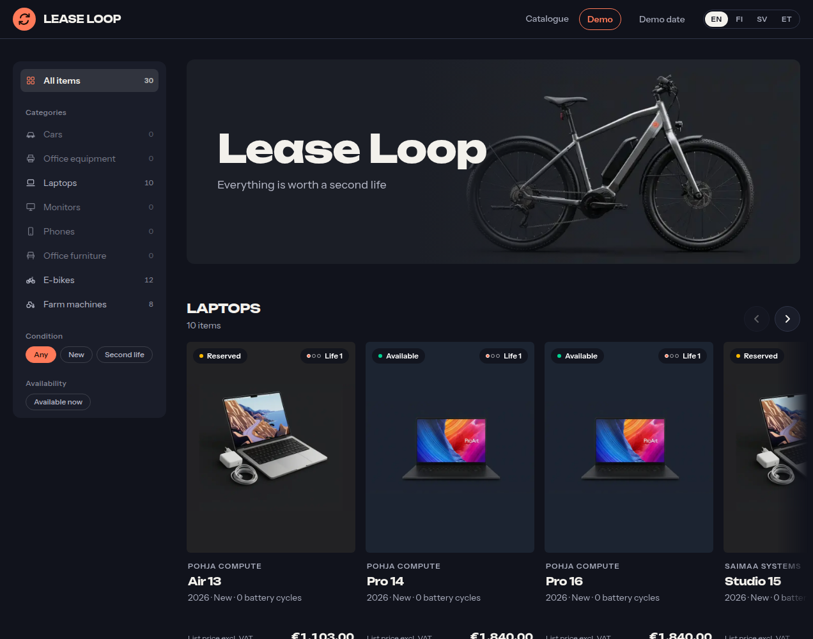
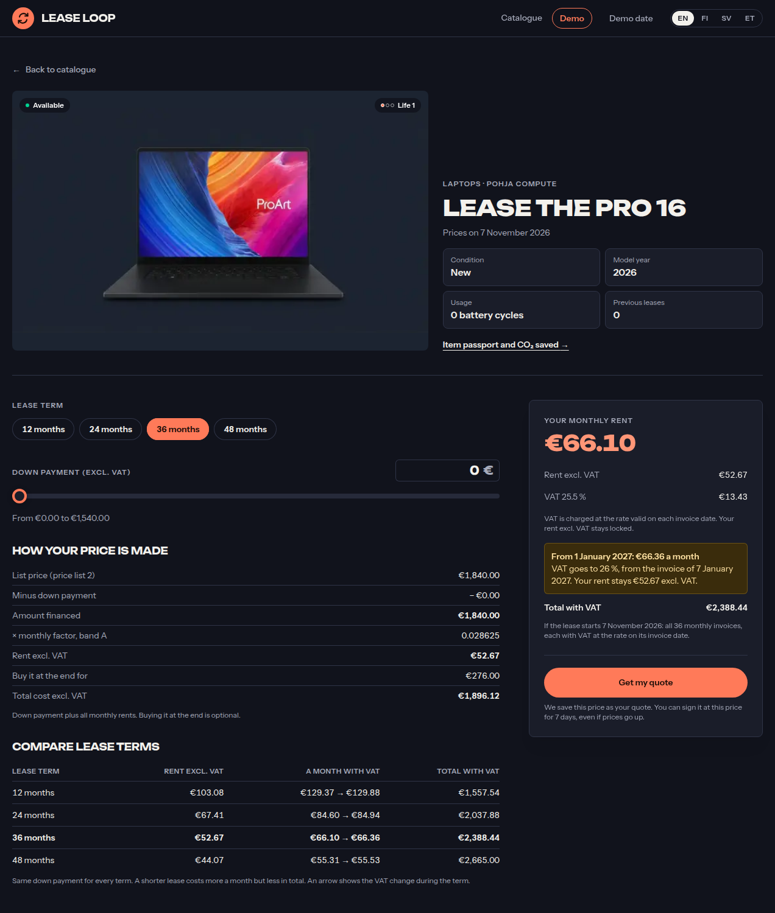
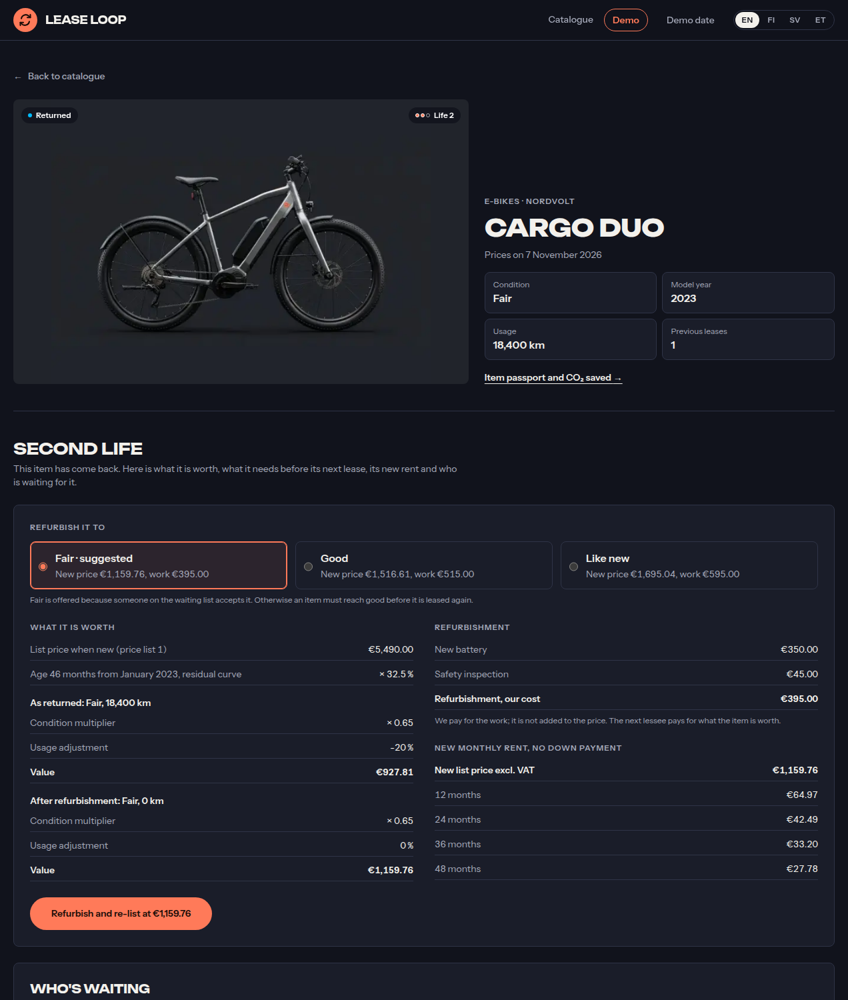

# Lease Loop · Northfina × Hive Helsinki hackathon

> **Final submission.** This is our team's entry for the **Lease Loop** challenge, 5–6 November 2026 at Hive Helsinki. The hackathon is over and the repo is kept as it was handed in, for anyone curious to see or run the project.

The challenge: build a circular-economy leasing app where one e-bike, laptop or tractor lives three lives. Our Lease Loop takes an item from the catalogue to a price, an application, a signed contract and monthly invoices, then back again as a refurbished, re-priced second-life item. Every cent is calculated by plain rules and tested, and the customer always sees how their price was made.

- 📋 **The challenge:** [CHALLENGE.md](CHALLENGE.md)
- 📐 **Engineering rules:** [RULES.md](RULES.md)
- 🗂️ **The data pack:** [data/DATA.md](data/DATA.md)

**Northfina** is a Helsinki-based leasing platform. It started as Etufillari, a bike-leasing service, and now leases any kind of asset. This repo is a small, independent playground, not Northfina's product code.

---

## Clone and run

You need **Git** and **Node.js 22** (with [nvm](https://github.com/nvm-sh/nvm): `nvm install` reads `.nvmrc`).

```bash
git clone https://github.com/slowTake/northfina-lease-loop.git
cd northfina-lease-loop
nvm install          # Node 22
npm ci               # installs dependencies
npm run db:setup     # creates .env and a local SQLite database with the 30 assets
npm run dev          # http://localhost:3000
```

Open <http://localhost:3000>. You land on the catalogue in English; switch to Finnish, Swedish or Estonian in the header. **Demo** in the header runs the challenge's scenario cards, and **Demo date** lets you set the day the app thinks it is, so you can watch prices and VAT change.

| Command             | What it does                              |
| ------------------- | ----------------------------------------- |
| `npm run dev`       | Start the app with hot reload             |
| `npm test`          | Run all tests once                        |
| `npm run check:all` | Every check: lint, types, tests, build    |
| `npm run db:reset`  | Wipe the local database and seed it again |

---

## A look around

### The catalogue

Every item shows today's price, whether it can be leased now and which life it is on.



### The pricing engine

Pick a lease term and a down payment and the monthly rent updates as you go. Underneath, **How your price is made** walks through every step from list price to rent, and a table compares all four terms. When VAT changes during the lease (25.5 % → 26 % on 1 January 2027), the app tells you which invoice it starts on; your rent excluding VAT stays locked.



### Second life

When an item comes back, the engine values it from its age, condition and usage, prices the refurbishment options, and gives the new monthly rent for each term before it is listed again.



---

## How it's built

- **Next.js** (App Router), **TypeScript**, **Prisma** with SQLite, **Tailwind CSS**, **Vitest**.
- **All business logic is pure functions in `src/domain/`**, with tests next to each one. No I/O, no clock, no randomness: dates and data come in as arguments.
- **Money is integer euro cents**, rounded once with a documented half-up rule.
- **Every data change writes an audit row** in the same transaction; see the audit log at `/audit`.
- **No AI in the product.** Pricing, eligibility and invoicing are rules and data. `npm run check:no-ai` enforces it.

## License

The original starter code is MIT-licensed (see [LICENSE](LICENSE)). Please follow the [Code of Conduct](CODE_OF_CONDUCT.md).
